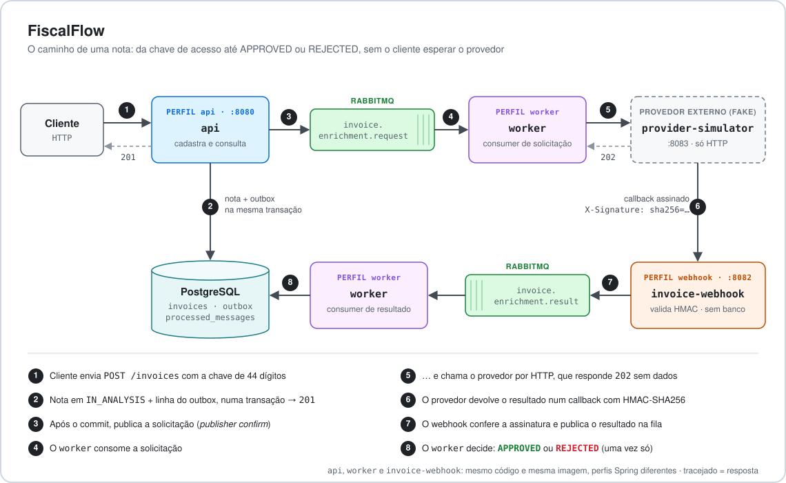
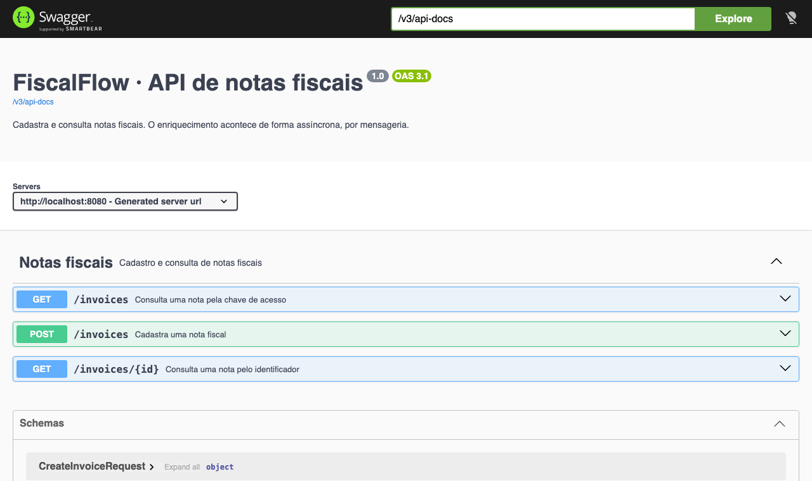
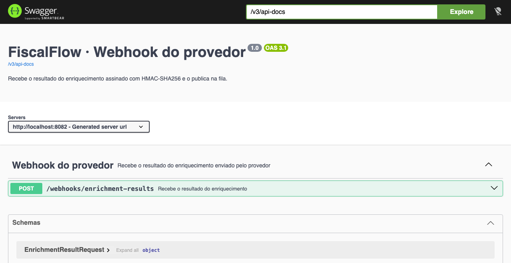
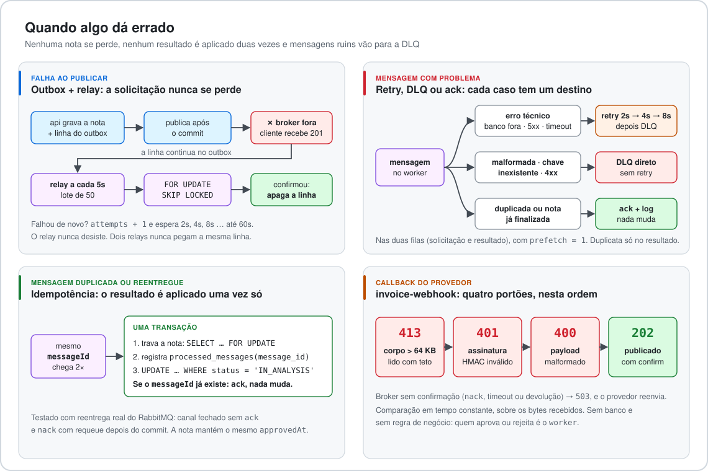

# FiscalFlow

Serviço de back end que recebe a chave de acesso de uma nota fiscal, grava a nota em `IN_ANALYSIS` e pede o enriquecimento a um provedor por mensageria. Quando o resultado chega, aprova ou rejeita a nota, **sem perder mensagens e sem aplicar o mesmo resultado duas vezes**.



Java 25 · Spring Boot 4.1 · RabbitMQ · PostgreSQL · Flyway · Testcontainers · springdoc · Docker Compose

| Serviço | Porta | Papel |
|---|---|---|
| `api` | 8080 | Cadastra e consulta notas. Grava nota + outbox e publica após o commit |
| `worker` | 8081 | Relay do outbox, chamada HTTP ao provedor e consumer do resultado |
| `invoice-webhook` | 8082 | Recebe o callback assinado (HMAC) do provedor e publica o resultado na fila. Não usa banco |
| `provider-simulator` | 8083 | Provedor externo fake, só HTTP (projeto Maven separado) |
| `rabbitmq` / `postgres` | 5672, 15672 / 5432 | Broker e banco |

`api`, `worker` e `invoice-webhook` são o mesmo código e a mesma imagem, com perfis Spring diferentes. As portas ficam só em `127.0.0.1`.

## Como subir

Requisito: Docker. Nenhuma conta externa.

**1. Crie o `.env`** a partir do exemplo. Os valores servem só para uso local e podem ser trocados à vontade:

```bash
cp .env.example .env
```

| Variável | Para que serve | Exemplo |
|---|---|---|
| `POSTGRES_DB`, `POSTGRES_USER`, `POSTGRES_PASSWORD` | Banco criado pelo container do Postgres e usado pela `api` e pelo `worker` | `invoice`, `invoice`, `invoice_dev_only` |
| `RABBITMQ_USER`, `RABBITMQ_PASSWORD` | Usuário do broker e login do painel (`:15672`) | `invoice`, `invoice_dev_only` |
| `WEBHOOK_HMAC_SECRET` | Segredo do HMAC, compartilhado entre o simulador (assina) e o `invoice-webhook` (confere) | qualquer texto |
| `PROVIDER_BASE_URL` | Para onde o `worker` envia a solicitação | `http://provider-simulator:8083` |
| `WEBHOOK_URL` | Para onde o simulador envia o callback | `http://invoice-webhook:8082` |

As 9 variáveis são obrigatórias. Se alguma faltar ou estiver vazia (por exemplo, num `.env` antigo), o Compose para antes de criar os containers e diz qual é:

```text
required variable WEBHOOK_URL is missing a value: defina WEBHOOK_URL no .env (veja o .env.example)
```

**2. Suba os serviços:**

```bash
docker compose up --build     # os seis serviços, com healthchecks
```

- Swagger da `api`: <http://localhost:8080/swagger-ui.html>
- Swagger do webhook: <http://localhost:8082/swagger-ui.html>
- RabbitMQ: <http://localhost:15672> (usuário e senha do `.env`)
- Health: `curl localhost:8080/actuator/health` (e `8081`, `8082`)

## Cadastrar e consultar uma nota

```bash
curl -i -X POST localhost:8080/invoices -H 'Content-Type: application/json' \
  -d '{"accessKey":"35260112345678000199550010000012341000012345"}'
# 201 Created, Location: /invoices/{id}, status IN_ANALYSIS

curl localhost:8080/invoices/{id}
curl 'localhost:8080/invoices?accessKey=35260112345678000199550010000012341000012345'
# cerca de 1 segundo depois: status APPROVED, com cnpj, amount, issueDate e approvedAt
```

| Situação | Resposta |
|---|---|
| Chave nova | `201` com a nota em `IN_ANALYSIS` |
| Chave repetida (inclusive com espaços nas pontas) | `200` com a mesma nota, sem nova solicitação |
| Chave fora de `^[0-9]{44}$`, JSON inválido | `400` em `application/problem+json`, em português |
| Corpo acima de 8 KB | `413` |
| `GET` de nota inexistente | `404` |

O `POST` nunca chama o provedor nem espera o enriquecimento. A nota só muda de estado quando o resultado é processado.



## Simular o provedor

O `provider-simulator` já sobe no Compose. Ele recebe `POST /enrichment-requests`, responde `202`, espera 300 ms e chama o webhook com um resultado **completo e aprovável**, assinado com HMAC-SHA256 (`WEBHOOK_HMAC_SECRET`). Se o webhook falhar, reenvia até 3 vezes.

Para ver uma **rejeição**, pare o simulador e mande o callback à mão:

<details>
<summary>Callback assinado com <code>cancelled: true</code></summary>

```bash
docker compose stop provider-simulator
KEY=35260112345678000199550010000012341000077777
curl -X POST localhost:8080/invoices -H 'Content-Type: application/json' -d "{\"accessKey\":\"$KEY\"}"

SECRET=$(grep ^WEBHOOK_HMAC_SECRET= .env | cut -d= -f2-)
BODY="{\"messageId\":\"$(uuidgen | tr A-Z a-z)\",\"eventType\":\"invoice.enrichment.completed\",\"occurredAt\":\"2026-11-10T12:00:00Z\",\"payload\":{\"accessKey\":\"$KEY\",\"cnpj\":\"12ABC34501DE35\",\"amount\":1500.00,\"issueDate\":\"2026-01-10\",\"cancelled\":true}}"
SIG=$(printf '%s' "$BODY" | openssl dgst -sha256 -hmac "$SECRET" | awk '{print $NF}')

curl -i -X POST localhost:8082/webhooks/enrichment-results \
  -H 'Content-Type: application/json' -H "X-Signature: sha256=$SIG" -d "$BODY"   # 202
curl "localhost:8080/invoices?accessKey=$KEY"   # REJECTED, "Nota cancelada pelo emitente"
docker compose start provider-simulator
```

Sem o cabeçalho, ou com o corpo alterado, a resposta é `401`. Com a solicitação parada, o `worker` tenta 3 vezes e a manda para `invoice.enrichment.request.dlq`.
</details>



## Fluxo da nota

1. `POST /invoices`: a `api` grava a nota em `IN_ANALYSIS` e a linha do outbox **na mesma transação** e responde `201`.
2. Depois do commit, em outra thread, a `api` publica a solicitação em `invoice.enrichment.request`, com *publisher confirm*, e apaga a linha do outbox.
3. O `worker` consome a solicitação e faz `POST {PROVIDER_BASE_URL}/enrichment-requests`. O provedor responde `202` sem dados.
4. O provedor chama `POST /webhooks/enrichment-results` com o resultado assinado. O `invoice-webhook` confere tamanho, assinatura e formato e publica em `invoice.enrichment.result`.
5. O `worker` consome o resultado, localiza a nota pela `accessKey` e decide, na ordem:
   1. `cancelled = true` → `REJECTED`: "Nota cancelada pelo emitente".
   2. Falta `cnpj`, `amount`, `issueDate` ou `cancelled` → `REJECTED`: "Enriquecimento incompleto: campos ausentes: …".
   3. CNPJ inválido (alfanumérico, com DV oficial), `amount` negativo ou acima de `NUMERIC(15,2)` → `REJECTED`: "Dados de enriquecimento inválidos: …".
   4. Senão → `APPROVED`, com os dados e o `approvedAt`.

`APPROVED` e `REJECTED` são finais. Diagramas de sequência em [docs/flow.md](docs/flow.md).

**Adaptação do enunciado.** O [DESAFIO.md](DESAFIO.md) diz que "o provedor publica o resultado". Aqui o provedor fala só HTTP, como um fornecedor real: ele chama um webhook assinado, e quem publica na fila em nome dele é o `invoice-webhook`. O contrato do resultado é o do enunciado.

## Contratos

As duas mensagens usam o mesmo envelope (`messageId`, `eventType`, `occurredAt`, `correlationId` e `payload`). São JSON persistente na exchange direct `invoice.enrichment`, e cada fila tem DLQ.

<details>
<summary><code>EnrichmentRequest</code>: fila <code>invoice.enrichment.request</code></summary>

```json
{
  "messageId": "6a1f0c58-3f2e-4b8e-9d1b-0d6b6e2c9a10",
  "eventType": "invoice.enrichment.requested",
  "occurredAt": "2026-11-04T12:00:00Z",
  "correlationId": "0b6f5c1e-8d2a-4c53-9a43-6f4b6a0f2f11",
  "payload": { "invoiceId": "0b6f5c1e-8d2a-4c53-9a43-6f4b6a0f2f11", "accessKey": "35260112345678000199550010000012341000012345" }
}
```
O `messageId` é o `id` da linha do outbox e não muda entre republicações.
</details>

<details>
<summary><code>EnrichmentResult</code>: fila <code>invoice.enrichment.result</code></summary>

```json
{
  "messageId": "c3b2f2a1-5d6e-3f7a-8b9c-1e2d3c4b5a69",
  "eventType": "invoice.enrichment.completed",
  "occurredAt": "2026-11-04T12:00:02Z",
  "correlationId": "0b6f5c1e-8d2a-4c53-9a43-6f4b6a0f2f11",
  "payload": { "accessKey": "35260112345678000199550010000012341000012345", "cnpj": "12ABC34501DE35", "amount": 1500.00, "issueDate": "2026-01-10", "cancelled": false }
}
```
Sem `messageId` ou `payload.accessKey`, ou com campo ilegível, a mensagem é malformada e vai para a DLQ. O `cancelled` ausente **não** vira `false`: a nota é rejeitada como incompleta.
</details>

| Chamada HTTP | Quem chama | Respostas |
|---|---|---|
| `POST {PROVIDER_BASE_URL}/enrichment-requests`, corpo `EnrichmentRequest` e `X-Correlation-Id` | `worker` | `202` ack · `4xx` DLQ direto · `5xx`, `3xx`, `408`, `429`, timeout ou conexão recusada: 3 retries e DLQ |
| `POST /webhooks/enrichment-results`, corpo `EnrichmentResult` e `X-Signature: sha256=<hex>` | provedor | `202` publicado · `413` acima de 64 KB · `401` assinatura · `400` payload · `503` broker sem confirmação |

O HMAC é calculado sobre o corpo bruto e comparado em tempo constante. A URL do callback é configuração do provedor e nunca vai na mensagem. Contratos completos em [docs/spec.md](docs/spec.md), seções 2 e 3.

## Falhas, duplicatas e reentregas



- **Falha ao publicar:** a solicitação está no outbox desde o commit da nota. Se a publicação imediata falhar (broker fora, `nack` ou devolução), o cliente recebe `201` do mesmo jeito e o relay do `worker` publica depois. O relay roda a cada 5s, com lote de 50, `FOR UPDATE SKIP LOCKED` e backoff de 2s até 60s, e nunca desiste. A entrega é *at-least-once*.
- **Duplicatas:** o consumer trava a nota (`FOR UPDATE`), grava o `messageId` em `processed_messages` e atualiza com `WHERE status = 'IN_ANALYSIS'`, tudo **na mesma transação**. Uma segunda entrega recebe `ack` e não muda nada. O simulador deriva o `messageId` do resultado do `messageId` da solicitação, então reenvios geram o mesmo id.
- **Reentrega provocada no teste:** chamar o método duas vezes não prova nada, então a reentrega vem do RabbitMQ.
  - `BrokerRedeliveryIntegrationTest`: um consumidor de teste com ack manual fecha o canal sem confirmar, e o broker reentrega com `redelivered = true`.
  - `ResultRedeliveryIntegrationTest`: um interceptador de teste, fora do retry, deixa o **consumer real** dar commit e então força `nack` com requeue. Na segunda entrega, a nota mantém o mesmo `approvedAt`, há uma linha em `processed_messages` e a DLQ fica vazia.

## Testes

Requisitos: JDK 25 e Docker (Testcontainers sobe PostgreSQL e RabbitMQ).

```bash
./mvnw verify                # tudo: 232 testes
./mvnw test -Punit           # sem os de integração
./mvnw test -Pintegration    # só integração com broker e banco reais
```

Os testes são de domínio, serviço (Mockito), HTTP (MockMvc), persistência e integração com o RabbitMQ real. Cada cenário da [spec](docs/spec.md#7-cenários-de-teste) tem pelo menos um teste (T1–T10, E1–E10, C1–C4 e H1–H9).

## Decisões técnicas

- **Outbox transacional** com publicação imediata após o commit e relay de segurança. A linha é apagada quando o broker confirma.
- **Unicidade pela constraint**: `INSERT … ON CONFLICT DO NOTHING` e releitura, sem `SELECT` prévio. Pedidos simultâneos com a mesma chave geram uma única nota.
- **Hexagonal enxuto**: `domain` sem Spring, `Invoice` com `approve` e `reject` e sem setters, e ports de saída. JPA para notas e `JdbcClient` para outbox e `processed_messages`, que usam SQL específico do PostgreSQL.
- **Destino por tipo de erro**: malformada e chave inexistente vão direto para a DLQ; erro técnico tem 3 retries (2s, 4s e 8s) e depois DLQ; duplicata e nota finalizada recebem `ack`.
- **Webhook defensivo**: corpo lido com teto antes do HMAC, e sem banco nem regra de negócio.

<details>
<summary>Limitações conhecidas e fora do escopo</summary>

- Nota sem resposta do provedor (ou com a solicitação na DLQ) fica em `IN_ANALYSIS` indefinidamente. O reprocessamento das DLQs é manual.
- O retry espera dentro do worker (`prefetch = 1`). Filas de retry com TTL evitariam o bloqueio.
- O relay segura os locks das linhas enquanto publica. A publicação imediata usa um executor limitado, e o excedente fica para o relay.
- Apagar a linha do outbox não deixa histórico de publicação.
- `cancelled` ausente rejeita a nota de forma irreversível.
- O HMAC não tem timestamp nem nonce: um callback capturado pode ser reenviado, e o efeito é contido pela idempotência. O segredo é simétrico e não tem rotação.
- O simulador deduplica em memória e só gera resultados aprováveis. As rejeições são cobertas pelos testes.
- O que é aceitável só em ambiente local: senhas e segredo de exemplo fracos no `.env.example`, usuário único no RabbitMQ, imagens sem digest, Maven Wrapper sem checksum, `415` respondido antes do `401` no webhook e `amount` arredondado para 2 casas.
- **Fora do escopo:** fornecedor fiscal real, SEFAZ, validação fiscal completa, nuvem, autenticação, interface gráfica e observabilidade externa (há logs em português com `correlationId` e Actuator).
</details>

## Uso de IA

O projeto foi construído com o Claude Code, fatia a fatia, a partir de uma spec escrita antes do código.

<details>
<summary>O que foi gerado e o que foi revisado</summary>

- **Gerado pela IA:** a spec e os diagramas a partir das decisões do autor, o código e os testes de cada fatia, os dois diagramas deste README e este texto. As versões das dependências foram conferidas na documentação oficial.
- **Revisado ou corrigido pelo autor:**
  - as decisões de desenho (provedor via webhook, outbox sem `published_at`, ordem da decisão);
  - a reorganização de pacotes;
  - o tratamento de `nack`;
  - correções apontadas nas revisões de cada fatia.
- **Agentes de revisão** (em [`.claude/agents/`](.claude/agents/)):
  - o de segurança encontrou o corpo do webhook sem limite antes do HMAC e as portas expostas em `0.0.0.0`. Os dois foram corrigidos, assim como a nota que ficava presa quando o dado não cabia na coluna;
  - o de boas práticas revisou a arquitetura e as convenções.

O registro completo, fatia a fatia, está em [docs/ai-usage.md](docs/ai-usage.md).
</details>

## Documentação

[docs/spec.md](docs/spec.md) (contratos, regras e cenários) · [docs/flow.md](docs/flow.md) (diagramas de sequência) · [DESAFIO.md](DESAFIO.md) (enunciado) · [docs/checklist.md](docs/checklist.md) (acompanhamento)
