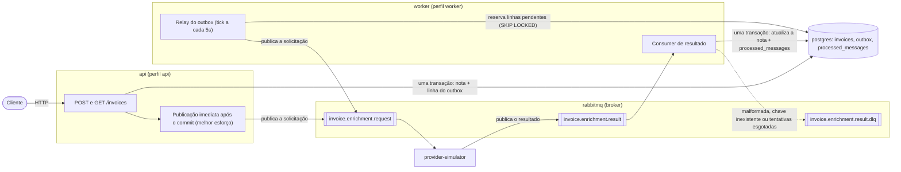
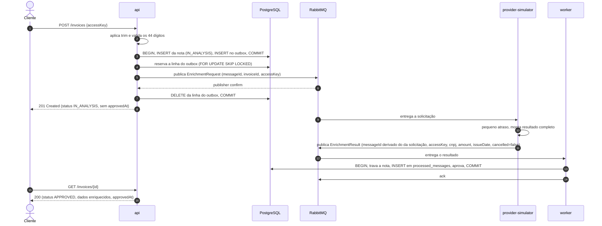
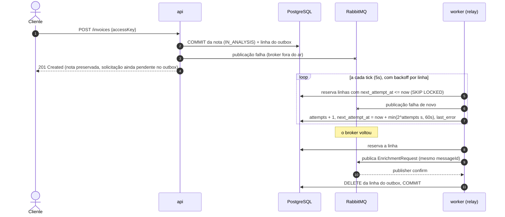
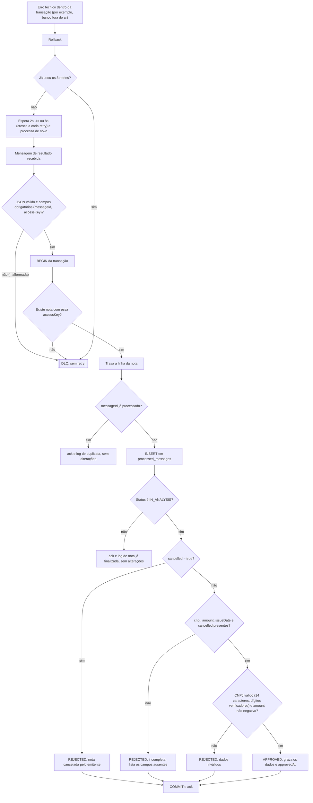
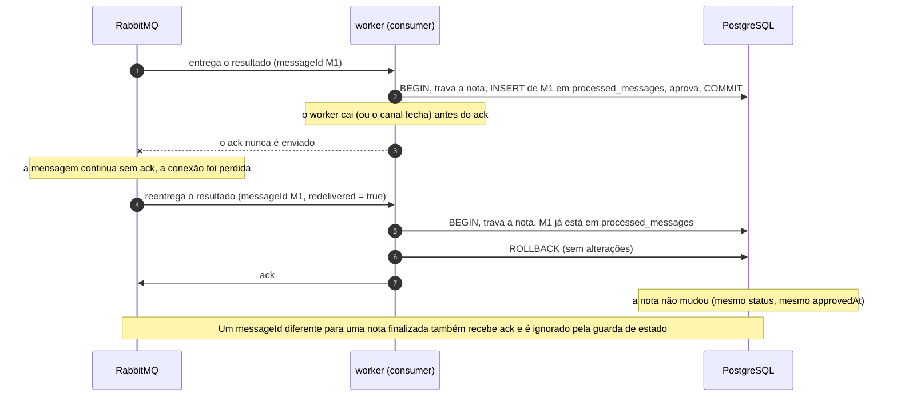
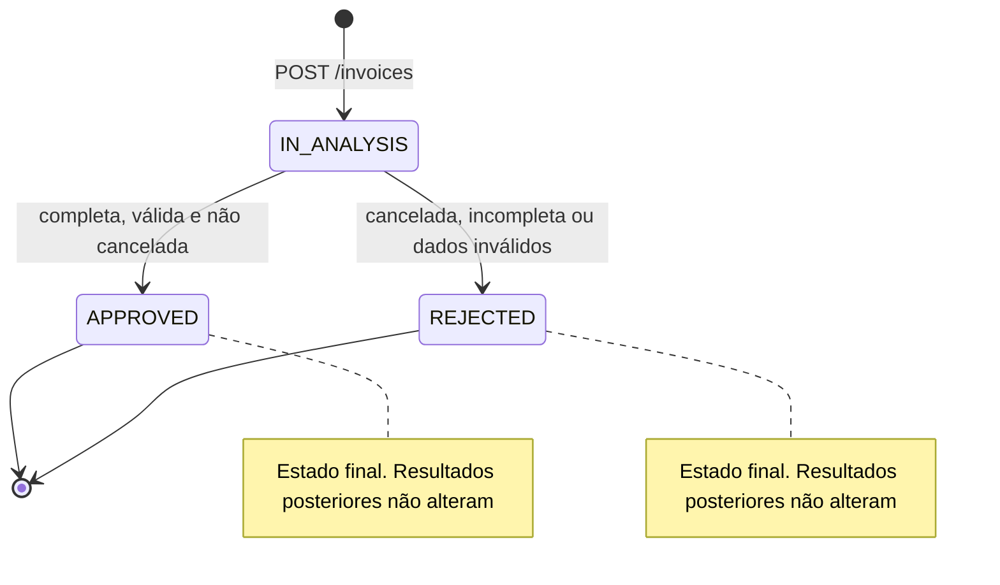
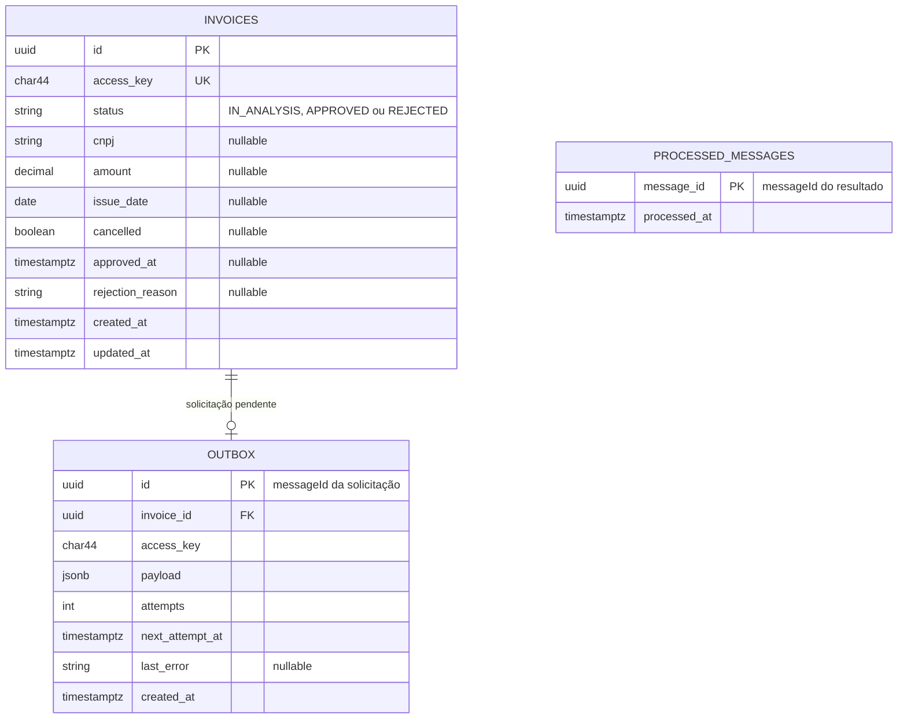

# Invoice Processing Pipeline — Fluxo e desenho

Este documento descreve o funcionamento do serviço de ponta a ponta. Ele é a referência para a implementação e será linkado no README.

Serviços (Docker Compose): `api`, `worker`, `provider-simulator`, `rabbitmq` (broker) e `postgres`.
`api` e `worker` compartilham o mesmo código e a mesma imagem, e sobem com perfis diferentes do Spring.

## 1. Visão geral

## 2. Fluxo feliz

A publicação imediata é disparada no `afterCommit` da transação da nota, em outra thread e numa transação nova, então o `POST` não espera o broker. Se ela falhar, o cliente recebe `201` do mesmo jeito e a nota continua `IN_ANALYSIS`. A linha do outbox permanece para o relay (seção 3).
O request nunca espera o provedor, e a nota nunca é aprovada durante a criação.

## 3. Falha de publicação e recuperação

O relay nunca desiste de uma linha, porque a solicitação não pode ficar esquecida. O backoff tem teto de 60s.

## 4. Decisão do consumer de resultado

Só o erro técnico é reprocessado. Mensagem malformada e chave inexistente vão direto para a DLQ, porque tentar de novo não resolveria.
Uma nota rejeitada mantém `approvedAt` vazio e grava um `rejectionReason` legível.

## 5. Mensagem duplicada e reentrega

Duas camadas protegem contra duplicidade: `processed_messages` (mesmo `messageId`) e a guarda de estado final (qualquer resultado para uma nota finalizada). O lock da linha serializa entregas concorrentes.

## 6. Estados da nota

## 7. Modelo de dados

Uma linha do outbox só existe enquanto a solicitação está pendente: ela é apagada na mesma transação que confirma a publicação.

## 8. Decisões refletidas aqui

- Relay agendado do outbox mais publicação imediata após o commit. Os dois usam a mesma função e `FOR UPDATE SKIP LOCKED`.
- A entrega é at-least-once. Uma queda entre a publicação e o commit pode publicar a solicitação duas vezes, então o provedor deve deduplicar pelo `messageId` da solicitação.
- Publicação imediata no `afterCommit` da transação que gravou a nota, em outra thread (`REQUIRES_NEW`), com falha só registrada em log.
- *Publisher confirm* correlacionado com `mandatory`: só apaga a linha com `ack` e sem devolução.
- Relay: tick de 5s, backoff exponencial (2s, 4s, 8s, 16s, 32s) com teto de 60s e sem limite de tentativas.
- Consumer: 3 retries dentro do worker, com esperas de 2s, 4s e 8s (até 4 execuções no total), e depois DLQ. Não há tabela de log de erros, a DLQ guarda a mensagem.
- O `messageId` do resultado é derivado do `messageId` da solicitação. Uma solicitação entregue duas vezes gera o mesmo resultado, que `processed_messages` descarta.
- Horários em UTC (`timestamptz` no banco, ISO-8601 na API).
- Criação duplicada (mesma chave de acesso): `200` com a nota existente. A garantia vem da constraint `UNIQUE`, e não de um `SELECT` prévio.
- Chave de acesso: passa por `trim` e precisa ter exatamente 44 dígitos. Fora disso, `400`.
- Idempotência dos resultados: `processed_messages` gravada na mesma transação do update, mais a guarda de estado final.
- Validação do resultado: CNPJ válido e valor não negativo. O CNPJ pode ser alfanumérico (14 caracteres, sem máscara, 12 primeiros em `A-Z` ou dígitos e 2 dígitos verificadores). Se falhar, a nota é rejeitada.

## 9. Limitações conhecidas

- A espera do retry acontece dentro do worker e bloqueia aquele consumer (`prefetch = 1`). Filas de retry com TTL evitariam isso.
- O relay mantém uma transação aberta no banco enquanto publica. Um broker lento segura os locks das linhas durante esse tempo.
- A publicação imediata usa um executor limitado. Se a fila dele encher, o relay publica as solicitações excedentes (até 5s depois).
- Apagar as linhas do outbox após a publicação não deixa histórico de publicação.
- O reprocessamento da DLQ é manual.
